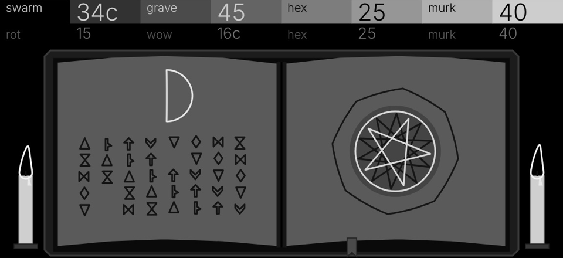

# Daath

A witch house bass engine for the OP-XY, built on the
[Open-XY SDK](https://github.com/etcetc000/open-xy) (OS 1.2.1, tested on SDK
`staging` at release 0.0.3; the machine format is SDK 1.4).

Five drifting saws over a sine an octave below, pushed through an asymmetric
drive, sunk under a pitch-tracking lowpass, rotted by sample-and-hold and bit
loss, and warped like slowed tape. The screen is a monochrome grimoire that
every knob rewrites.



▶ **[Sound and screen tour (MP4)](media/daath-tour.mp4)**: every control, then
every preset.

## Controls

Pressing any encoder switches both rows. Hex and Murk sit on both pages.

| Encoder | Page 1 | Page 2 |
| --- | --- | --- |
| Blue | **Swarm**: detune of four ghost saws around the centre saw, 0 to 40 cents. At 0 it is one clean saw | **Rot**: sample-and-hold from 44.1 kHz down to 1.4 kHz with up to 21 bits lost. 0 is a true bypass |
| Green | **Grave**: level of the sine one octave below | **Wow**: tape warp, two slow drifting rates, up to 45 cents |
| White | **Hex**: asymmetric cubic drive, gain 1 to 15 with even-harmonic bias and level trim | same |
| Orange | **Murk**: two-pole lowpass that tracks the note, from 256 harmonics down to the fundamental | same |

The header shows Swarm and Wow in cents and the rest as amounts 0 to 100.
Colouring and degrading controls (Hex, Rot, Wow) default to off.

## Presets

Six presets ship with the engine and install with the builder.

| Preset | Swarm | Grave | Hex | Murk | Rot | Wow | Character |
| --- | --- | --- | --- | --- | --- | --- | --- |
| **Sigil** (default) | 35 | 50 | 0 | 30 | 0 | 0 | The clean starting bass |
| **Crypt** | 60 | 80 | 35 | 55 | 0 | 25 | Heavy, sub-led, slightly warped |
| **Coven** | 85 | 45 | 25 | 40 | 15 | 35 | Wide choir of saws with a little grit |
| **Screwed** | 50 | 70 | 20 | 65 | 0 | 70 | Dark, slowed and seasick |
| **Hexed** | 45 | 60 | 85 | 35 | 0 | 10 | Driven and snarling |
| **Rotten** | 40 | 60 | 40 | 30 | 80 | 20 | Crushed and decayed |

## The grimoire

| Control | On the page |
| --- | --- |
| Swarm | Two ghost pentagrams split from the sigil and turn apart by up to 24 degrees |
| Grave | The moon waxes from a sliver to full, turns to a black sun past 75 and sinks |
| Hex | The candles flare taller and the summoning ring grows eight flames |
| Murk | The pages darken to black; the runes and sigil then glow white |
| Rot | Up to 55% of the runes crumble away, the rest shake loose, and the pages tear |
| Wow | While a note is held, the sigil sways and the rune lines waver |

Each note flashes the sigil and throws a halo; holding a note turns the sigil
slowly. An idle screen stays still, and reduced motion shows the end state at
once.

## Build and test

Check out the SDK beside this repository at the commit pinned in
[the workflow](.github/workflows/machine.yml), then:

```sh
python ../open-xy/sdk.py preview --source . --out ../open-xy/local/daath-preview-001
python ../open-xy/tools/serve_harness.py --preview ../open-xy/local/daath-preview-001
python ../open-xy/sdk.py test --machine . --host-cxx g++
```

Open http://127.0.0.1:8917/, enable audio and play. For a device build, follow
the SDK's [build guide](https://github.com/etcetc000/open-xy/blob/staging/docs/build.md)
with `--machine` pointing here. Daath asks for engine 48 and page 96; a
firmware's layout may give it others.

| File | Owns |
| --- | --- |
| [definition.json](definition.json) | Controls, presets, resources and drawing budget |
| [core.h](core.h), [engine.cpp](engine.cpp) | Voice state and the integer DSP |
| [tables.h](tables.h) | Sub sine and Hex soft-clip tables (generated) |
| [display.h](display.h), [display.cpp](display.cpp), [panel.svg.fragment](panel.svg.fragment) | The grimoire and two-row header |
| [presets/](presets) | The six device presets (generated from definition.json) |
| [generators/](generators) | Scripts that regenerate tables, presets and artwork |
| [tests/](tests) | Host checks: bounds, presets, tuning, controls and display |
| [AUDIT.md](AUDIT.md) | DSP design, validation and what remains pending |

## Sound model

Everything is fixed point: Q27 signals with headroom, Q31 coefficients, no
floating point, no 64-bit arithmetic and no per-sample division.

- **Swarm**: five polyBLEP saws. Edge positions use a reciprocal computed once
  per block per saw. Ghost offsets are uneven (+1, −1, +0.43, −0.37 of the
  spread), so the beating never locks into a pulse. The ghosts fade in over
  the first quarter of the knob, and the mix is normalised by 1/(1 + 2g).
- **Grave**: a 1024-point table sine at half the centre saw's increment, so it
  follows Wow and bends exactly.
- **Hex**: gain on a squared curve with up to a quarter of bias, through a
  4096-point soft-clip table x − 4x³/27 at half scale. A DC blocker follows
  (about 14 Hz). Output trims by up to 5.6 dB over the first half of the knob.
- **Murk**: two cascaded one-poles. The coefficient follows the played
  increment, so the tone is the same in every octave.
- **Rot**: a branchless sample-and-hold clock and a bit mask on the held sample.
- **Wow**: two slow sines (about 0.43 and 1.1 Hz, varied per voice) bend every
  oscillator.

Oscillators run freely across notes, so legato and mono lines never click;
the OP-XY's envelopes, filter, LFOs and FX shape everything after the engine.

## Polyphony and CPU

Daath plays **8 voices** at once (`voiceCapacity` 8). That matches stock's
limit of 8 notes per track, so one track never steals from itself beyond its
own voices. Voice memory is 88 bytes per voice, plus stock's one spare.

CPU, from the SDK's host-timed estimate at Daath's heaviest setting (SDK
commit `4a8abf4`, seven runs on a 2-core Xeon at 2.1 GHz, 29 October 2026):

| Reading | Blackfin instructions per voice block |
| --- | --- |
| Median | about 17,300 |
| Range | about 13,600 to 23,700 (timing noise) |
| SDK aim | at most 15,000 |
| For scale | 2op FM about 14,000, Macro Osc about 9,000 |

This is an estimate from host timing, **not a measurement on the OP-XY**.
Fewer voices limit how many run at once; they do not change the cost of each
voice. The hardware readout from the SDK's
[profiling guide](https://github.com/etcetc000/open-xy/blob/staging/docs/profiling.md)
is still pending.

## Licence

MIT; see [LICENSE](LICENSE).
